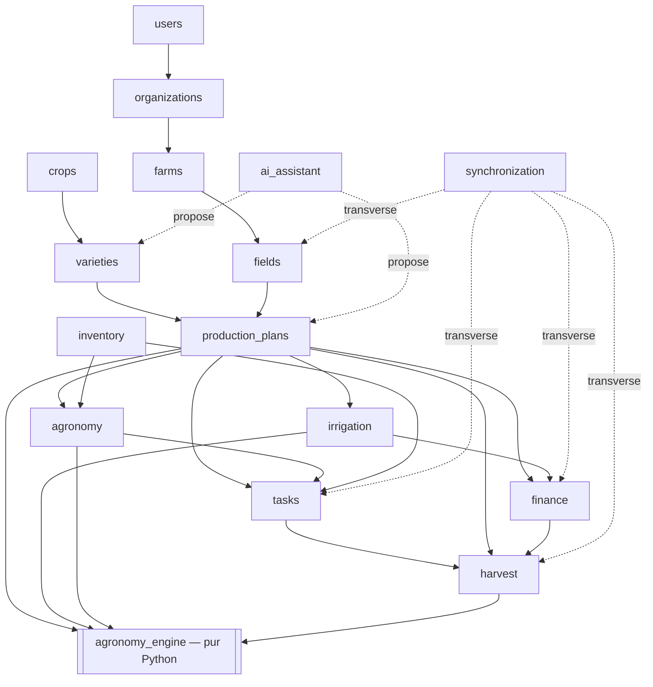
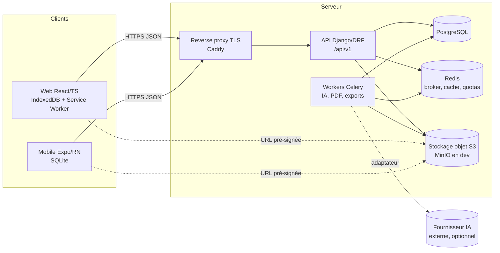
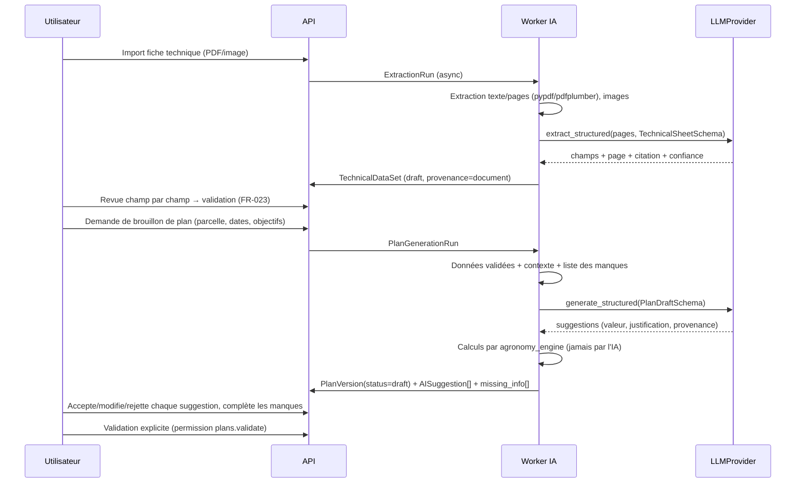

# ARCHITECTURE.md

> Statut : **proposition — en attente de validation humaine**
> Date : 2026-11-08
> Documents de référence : `PROJECT_CONTEXT.md`, `REQUIREMENTS.md`, `CLAUDE.md`
> Documents détaillés associés :
> - `DATABASE_SCHEMA.md` — modèle de données et ERD.
> - `docs/architecture/OFFLINE_SYNC.md` — protocole offline-first et synchronisation.
> - `docs/architecture/AGRONOMY_ENGINE.md` — moteur de calcul agronomique.
> - `IMPLEMENTATION_PLAN.md` — phases de développement.

---

## 0. Analyse des exigences

### 0.1 Domaines métier (bounded contexts)

| Domaine | Responsabilité | Exigences | Module backend |
|---|---|---|---|
| Identité et accès | Utilisateurs, authentification, appareils, invitations | FR-003, NFR-001 | `users` |
| Organisation (tenancy) | Organisations, exploitations, adhésions, rôles, permissions | FR-001..005 | `organizations`, `farms` |
| Foncier | Champs, parcelles, analyses de sol, historique cultural | FR-010 | `fields` |
| Référentiel végétal | Espèces, variétés, fiches techniques, données techniques validées | FR-020..023 | `crops`, `varieties` |
| Planification de production | Campagnes, plans, versions, paramètres de plantation, phases, cycles culturaux | FR-030..035 | `production_plans` |
| Irrigation | Dimensionnement, nomenclature, catalogue, devis | FR-040..043 | `irrigation` |
| Agronomie | Programme de fertilisation, phytosanitaire, irrigation programmée, observations | FR-050..053 | `agronomy` |
| Exécution | Tâches, affectations, comptes rendus, consommations | FR-060..064, FR-082 | `tasks` |
| Ressources | Catalogue d'intrants, fournisseurs, stocks | FR-080..081 (P1) | `inventory` |
| Trésorerie | Comptes, transactions, transferts, soldes, budgets | FR-070..078 | `finance` |
| Récolte | Récoltes, pertes, rendements, bilan | FR-090..092 | `harvest` |
| Assistance IA | Extraction, structuration, génération de brouillons, coûts | FR-100..107 | `ai_assistant` |
| Synchronisation | Journal des changements, réception idempotente, conflits | FR-110..115, NFR-003 | `synchronization` |
| Transverse | Fichiers, audit, unités, monnaie | NFR-002, NFR-007, NFR-008 | `core`, `files`, `audit` |

### 0.2 Dépendances entre modules



Règles de dépendance :
- Aucune dépendance circulaire entre applications Django. Un module en aval référence un module en amont, jamais l'inverse.
- `ai_assistant` ne fait que **proposer**. Il écrit uniquement dans ses propres tables (runs, suggestions). Une suggestion ne devient une donnée métier qu'après acceptation explicite, via le service du module concerné.
- `agronomy_engine` est un paquet Python pur : pas de Django, pas d'ORM, pas d'appel réseau. Tous les modules métier peuvent l'appeler.

### 0.3 Entités principales

Organization, Farm, User, FarmMembership, Role, Field, Parcel, Crop, Variety, TechnicalDocument, TechnicalDataSet, Campaign, **ProductionPlan / PlanVersion** (objet central), CropCycle, PlantingSpec, IrrigationDesign, BomLine, Quote, PlannedFertilization, PlannedPhytoIntervention, Observation, Task, TaskReport, InputConsumption, TreasuryAccount, FinancialTransaction, LedgerEntry, BudgetLine, HarvestRecord, StoredFile, ChangeLog, SyncOperationReceipt, SyncConflict, AuditEvent. Le détail est dans `DATABASE_SCHEMA.md`.

### 0.4 Principaux risques architecturaux

| # | Risque | Impact | Mitigation |
|---|---|---|---|
| R1 | Fuite de données entre organisations | Critique | Contexte de tenant obligatoire dans chaque vue, querysets filtrés par défaut, suite de tests d'isolation générée sur tous les endpoints (§6) |
| R2 | Doublons financiers lors de la synchronisation | Critique | Clé d'idempotence unique en base, transactions financières en ajout seul, aucun « last write wins » (OFFLINE_SYNC §7) |
| R3 | Perte d'opérations locales (stockage effacé, application désinstallée, quota IndexedDB) | Élevé | Stockage persistant demandé, opération jamais supprimée avant accusé serveur, alerte si la file reste longtemps non synchronisée, export de secours |
| R4 | Curseur de synchronisation qui saute des changements (commits hors ordre) | Élevé | Séquence par exploitation incrémentée sous verrou dans la même transaction (OFFLINE_SYNC §5) |
| R5 | L'IA présente une supposition comme une donnée documentaire | Élevé | Provenance obligatoire par champ, citation et page exigées pour la provenance « document », validation humaine (§8) |
| R6 | Erreurs d'unités dans les calculs | Élevé | Unité dans le nom de colonne, `Decimal` partout, moteur pur testé par propriétés (AGRONOMY_ENGINE §2) |
| R7 | Recommandation phytosanitaire non autorisée localement | Élevé (légal, sanitaire) | Aucune dose générée par le système, dose issue de l'étiquette ou de l'utilisateur, champ d'autorisation produit, avertissement explicite |
| R8 | Complexité monorepo Expo + Web + paquet partagé | Moyen | Paquet partagé sans dépendance UI, compatibilité vérifiée en début de phase mobile, repli npm workspaces |
| R9 | Expiration de session pendant une longue période hors ligne | Moyen | Refresh token longue durée lié à l'appareil, actions locales possibles sans réseau, ré-authentification avant envoi (§11) |
| R10 | Révocation de droits pendant que l'appareil est hors ligne | Moyen | Permissions revérifiées à la réception, opérations refusées gardées visibles, purge locale déclenchée par le serveur |
| R11 | Coûts et indisponibilité du fournisseur IA | Moyen | Mode dégradé manuel complet (FR-106), quotas par organisation, journal des coûts (FR-107) |
| R12 | Connectivité faible en République du Congo | Moyen | Lots compressés et paginés, reprise sur coupure, photos compressées côté client, file de fichiers séparée |

### 0.5 Ambiguïtés identifiées

Elles sont reprises en §15 sous forme de questions à valider. En résumé : granularité parcelle/planche, validation des dépenses, multi-devise, authentification des ouvriers sans e-mail, appareils partagés, catalogue global ou propre à l'organisation, étendue du mode hors ligne pour la conception des plans, et tolérance sur les incohérences de superficie.

---

## 1. Architecture générale



Décisions :

| Décision | Choix | Justification |
|---|---|---|
| Style | Monolithe modulaire Django | 10 à 30 utilisateurs par exploitation : des microservices ajouteraient du coût d'exploitation sans bénéfice. La modularité vient des frontières entre applications et des services métier. |
| API | REST versionnée `/api/v1`, JSON, OpenAPI généré | Exigence du projet. Le schéma OpenAPI sert à générer les types TypeScript des clients. |
| Source de vérité | Le serveur | Les clients gardent un cache local et une file d'opérations, mais la validation, les permissions et les soldes sont décidés par le serveur. |
| Tâches longues | Celery + Redis | Les extractions IA, l'analyse PDF et les exports ne doivent pas bloquer les requêtes HTTP. Celery est mature et bien documenté. *Alternative envisagée :* Procrastinate (file sur PostgreSQL, sans Redis). Elle reste possible si l'on veut réduire l'infrastructure. |
| Fichiers | Stockage objet compatible S3 | Fichiers hors base de données, URLs pré-signées courtes délivrées après contrôle des droits. |
| Monorepo | Un seul dépôt : backend Python (uv) + workspaces JavaScript | Les versions d'API, les types partagés et les changements transverses restent cohérents. |

Structure du dépôt proposée (ajustement de la cible de `CLAUDE.md`) :

```
farm-management/
├── CLAUDE.md, PROJECT_CONTEXT.md, REQUIREMENTS.md
├── ARCHITECTURE.md, DATABASE_SCHEMA.md, IMPLEMENTATION_PLAN.md
├── docker-compose.yml            # postgres, redis, minio, backend, worker
├── .env.example
├── package.json / pnpm-workspace.yaml
├── backend/
│   ├── pyproject.toml, uv.lock
│   ├── manage.py
│   ├── config/                   # settings (base/dev/test/prod), urls, celery, wsgi/asgi
│   ├── agronomy_engine/          # paquet Python PUR, sans Django (calculs déterministes)
│   ├── apps/
│   │   ├── core/                 # modèles de base, tenancy, unités, monnaie, pagination, erreurs
│   │   ├── audit/                # journal d'audit append-only
│   │   ├── files/                # StoredFile, stockage, URLs pré-signées
│   │   ├── users/  organizations/  farms/  fields/
│   │   ├── crops/  varieties/  production_plans/  irrigation/  agronomy/
│   │   ├── tasks/  inventory/  finance/  harvest/
│   │   ├── ai_assistant/
│   │   └── synchronization/
│   └── tests/                    # tests transverses (isolation multi-tenant, scénarios E2E API)
├── frontend/web/                 # Vite + React + TS
├── mobile/app/                   # Expo + RN + TS
├── packages/
│   ├── shared/                   # types API générés, schémas Zod, unités, formatage
│   └── sync-core/                # moteur de file/synchro agnostique du stockage
├── docs/
│   ├── architecture/             # OFFLINE_SYNC.md, AGRONOMY_ENGINE.md
│   └── adr/                      # Architecture Decision Records
└── scripts/
```

Écarts par rapport à la cible de `CLAUDE.md`, avec leur justification :
- `apps/core`, `apps/audit` et `apps/files` sont ajoutés pour isoler les préoccupations transverses.
- `backend/agronomy_engine/` est placé hors de `apps/` pour garantir son indépendance vis-à-vis de Django (CLAUDE.md §9).
- `packages/sync-core` est séparé de `packages/shared`. Web et Mobile partagent ainsi la même logique de file d'attente, et seul l'adaptateur de stockage change.

---

## 2. Architecture backend

### 2.1 Pile technique (versions à vérifier et verrouiller en Phase 0)

| Composant | Cible | Rôle / justification |
|---|---|---|
| Python | 3.12 (géré par uv) | Supporté par Django 5.2. La version 3.11.8 est présente localement. |
| Django | 5.2 LTS | Support long terme jusqu'en avril 2028, adapté à un produit qui doit durer |
| Django REST Framework | 3.16.x | Exigé |
| PostgreSQL | 17 (Docker) | `NUMERIC`, `JSONB`, contraintes d'exclusion (`btree_gist`), triggers |
| djangorestframework-simplejwt | dernière stable | JWT access/refresh avec rotation, adapté au mobile et au hors ligne |
| drf-spectacular | dernière stable | OpenAPI 3, documentation API, génération des types TypeScript |
| django-filter | dernière stable | Filtres déclaratifs sur les listes |
| django-storages + boto3 | dernière stable | Stockage S3 / MinIO |
| Celery + redis-py | 5.x | Tâches asynchrones |
| pypdf / pdfplumber | dernière stable | Extraction du texte des fiches techniques |
| Pillow | dernière stable | Validation et miniatures des images |
| Outils | ruff (lint + format), mypy + django-stubs, pytest, pytest-django, factory_boy, hypothesis | Qualité exigée en CLAUDE.md §13. hypothesis sert aux tests de propriétés du moteur. |

Dépendances écartées : `django-tenants` (schéma par tenant, incompatible avec un utilisateur multi-exploitations et lourd en migrations), `django-guardian` (permissions par objet trop fines pour le besoin), `pint` (gestion des unités ; un module explicite en `Decimal` est plus sûr et plus simple), `django-simple-history` (remplacé par l'audit et le versionnage explicites, plus adaptés à la finance).

### 2.2 Couches dans chaque application

```
apps/<module>/
├── models.py         # modèles explicites, contraintes en base
├── services/         # logique métier, transactions, invariants (point d'entrée unique des écritures)
├── selectors.py      # lectures complexes, toujours filtrées par tenant
├── serializers.py    # validation des entrées et forme des sorties, sans règle métier
├── views.py          # ViewSets minces : authentification, permission, appel au service
├── permissions.py    # permissions DRF spécifiques au module
├── sync.py           # déclaration des entités synchronisables et de leur stratégie
├── urls.py
└── tests/
```

Règles :
- Les vues n'écrivent jamais directement dans l'ORM. Elles appellent un service.
- Un service reçoit un `TenantContext` (utilisateur, organisation, exploitation, permissions effectives) et ne fait confiance à aucun identifiant de tenant envoyé par le client.
- Les écritures multi-tables s'exécutent dans `transaction.atomic()`. Les opérations financières verrouillent les lignes concernées avec `select_for_update`.
- Les services sont réutilisés à l'identique par l'API REST et par le traitement des opérations de synchronisation. Il n'y a qu'un seul chemin d'écriture.

### 2.3 Conventions API

- Ressources rattachées à une exploitation : `/api/v1/farms/{farm_id}/parcels/`, `/api/v1/farms/{farm_id}/transactions/`, etc. Le `farm_id` de l'URL est résolu contre les adhésions de l'utilisateur **avant** tout traitement.
- Ressources rattachées à une organisation : `/api/v1/organizations/{org_id}/varieties/`.
- Pagination par curseur pour les listes volumineuses (NFR-004).
- Concurrence optimiste : chaque ressource modifiable expose `version`. Les `PATCH` exigent `If-Match: <version>`, sinon le serveur répond `428`. Une version obsolète renvoie `409` avec l'état serveur.
- Idempotence : tout `POST` de création accepte l'en-tête `Idempotency-Key` (UUID), obligatoire pour les créations financières.
- Erreurs : format uniforme `{code, message, details, field_errors}` inspiré de RFC 9457 (Problem Details).
- Un identifiant appartenant à une autre organisation produit un `404`, jamais un `403`, pour ne pas révéler son existence.

---

## 3. Architecture frontend Web

| Composant | Choix | Justification |
|---|---|---|
| Build | Vite | Rapide, standard pour React et TypeScript |
| UI | React 19, TypeScript `strict`, Tailwind CSS 4 | Exigé (PROJECT_CONTEXT §7) |
| Routage | React Router | Standard, routes imbriquées par exploitation |
| État serveur | TanStack Query | Cache, invalidation, états de chargement et d'erreur |
| Stockage local | Dexie (IndexedDB) | API transactionnelle typée, index, migrations de schéma |
| Formulaires | React Hook Form + Zod | Validation explicite (CLAUDE.md §7). Les schémas Zod sont partagés avec le mobile. |
| Hors ligne | Service Worker (vite-plugin-pwa / Workbox) | Mise en cache de l'application pour démarrer sans réseau |
| Tests | Vitest, Testing Library, Playwright (E2E, mode hors ligne simulé) | |

Organisation du code :

```
frontend/web/src/
├── app/            # bootstrap, routeur, providers, garde d'authentification
├── features/<domaine>/
│   ├── components/ # présentation pure
│   ├── hooks/      # état applicatif (requêtes, mutations locales)
│   └── model/      # logique métier côté client (validation, dérivations d'affichage)
├── api/            # client HTTP typé (généré depuis l'OpenAPI)
├── storage/        # schéma Dexie et adaptateur sync-core
├── sync/           # orchestration : déclencheurs, Web Locks, indicateurs
└── ui/             # composants réutilisables (Button, Field, ConfirmDialog, SyncBadge, EmptyState…)
```

Points clés :
- **Lecture locale d'abord** pour les entités synchronisées. L'écran lit Dexie, et TanStack Query sert uniquement aux données en ligne (rapports, plans, IA).
- **Une seule boucle de synchronisation par navigateur**, coordonnée entre onglets avec l'API Web Locks.
- `navigator.storage.persist()` est demandé à la connexion. Si le navigateur refuse, l'utilisateur est averti du risque d'effacement.
- Indicateurs obligatoires : un badge global (en ligne / hors ligne / N opérations en attente / conflits) et un statut par élément (`pending`, `syncing`, `synced`, `failed`, `conflict`).
- Les opérations sensibles (annulation de transaction, validation de plan, suppression) passent par un dialogue de confirmation.
- Interface responsive en mobile d'abord (NFR-006). Les formulaires de terrain fonctionnent dès 360 px de large.

---

## 4. Architecture mobile

| Composant | Choix | Justification |
|---|---|---|
| Framework | Expo (dernier SDK stable au démarrage de la phase), React Native, TypeScript strict | Exigé |
| Navigation | Expo Router | Standard Expo |
| Stockage local | expo-sqlite | Exigé (SQLite). Transactions, adapté à de gros volumes locaux. |
| Accès SQL | Drizzle ORM (expo-sqlite driver) **ou** SQL direct | À trancher en début de phase mobile après vérification de compatibilité. Le SQL direct sert de repli sans dépendance. |
| Secrets | expo-secure-store | Refresh token, clé de l'appareil |
| Médias | expo-image-picker / expo-camera, expo-image-manipulator | Photo puis compression avant mise en file |
| Fichiers | expo-file-system | Copie des pièces jointes dans le répertoire de l'application, jamais un simple lien vers la galerie |
| Réseau | @react-native-community/netinfo | Déclencheur de synchronisation |
| Tests | Jest + React Native Testing Library ; Maestro pour l'E2E (à valider) | |

Partage avec le Web :
- `packages/shared` contient les types générés depuis l'OpenAPI, les schémas Zod, les unités, le formatage des dates et devises, les codes de permission et les énumérations.
- `packages/sync-core` contient la file d'opérations, la machine d'états des statuts, le protocole push/pull et la politique de retry. Une interface `SyncStore` est implémentée par `DexieStore` (Web) et `SqliteStore` (Mobile).
- Aucun composant d'interface n'est partagé, car React DOM et React Native sont différents. Seule la logique l'est.

Exécution en arrière-plan : la synchronisation tourne au premier plan (au démarrage, au retour du réseau, à intervalle régulier et manuellement). `expo-background-task` peut s'y ajouter en tâche opportuniste, sans jamais être la seule voie, car l'OS ne garantit pas son exécution.

---

## 5. Architecture de synchronisation (résumé)

Le détail est dans `docs/architecture/OFFLINE_SYNC.md`.

- **Outbox locale** : chaque mutation locale est une opération avec UUID (qui sert de clé d'idempotence), type, entité, charge utile, `base_version`, auteur, appareil, horodatage client et statut (`pending` → `syncing` → `synced` / `failed` / `conflict`).
- **Push** `POST /api/v1/sync/push` : lot ordonné d'opérations. Chaque opération est traitée dans sa propre transaction, par le même service métier que l'API REST. Le serveur enregistre un reçu unique par `op_id`, et un rejeu renvoie le reçu existant sans réappliquer l'opération.
- **Pull** `GET /api/v1/sync/pull?farm=…&cursor=…` : flux des changements depuis le curseur, à partir d'une séquence monotone par exploitation, filtré par les permissions de l'utilisateur. Il inclut les suppressions (tombstones).
- **Stratégies par classe de données** :
  - Descriptif (parcelles, variétés) : concurrence optimiste avec fusion à trois sur les champs modifiés. Un conflit n'apparaît que si le même champ a changé des deux côtés.
  - Événements agricoles (comptes rendus, observations, récoltes) : ajout seul, donc pas de conflit d'écriture. Les transitions d'état incompatibles sont signalées « à vérifier ».
  - Financier : ajout seul et immuable. Aucune fusion automatique. Une correction passe par une annulation ou une écriture corrective. Les doublons probables sont signalés, jamais fusionnés.
- Une opération locale n'est supprimée **qu'après** accusé serveur (`applied`, ou `rejected` reconnu par l'utilisateur).

---

## 6. Architecture multi-tenant

### 6.1 Modèle

- **Base partagée, schéma partagé, isolation par ligne.** Toute table métier porte `organization_id`, et `farm_id` si la donnée appartient à une exploitation.
- Hiérarchie : `Organization 1—N Farm`. Un `User` est lié à une organisation par `OrganizationMembership` et à une exploitation par `FarmMembership(role)`. Un même utilisateur peut avoir des rôles différents selon les exploitations (PROJECT_CONTEXT §3).
- Portée des données :
  - Données propres à une exploitation : parcelles, campagnes, plans, tâches, finances, récoltes, stocks, observations.
  - Données de l'organisation : variétés, fiches techniques, fournisseurs, catalogue, listes de prix, rôles personnalisés, catégories financières.
  - Données globales en lecture seule : catalogue des espèces de référence, codes de permission, devises ISO 4217, unités.

Justification face au schéma par tenant : un utilisateur peut appartenir à plusieurs exploitations, les volumes sont modestes et les migrations doivent rester simples. L'isolation par ligne avec une application systématique en couche applicative et des tests automatisés est plus simple et suffisante. La **Row-Level Security PostgreSQL** est retenue comme durcissement en P1 (défense en profondeur).

### 6.2 Application de l'isolation

1. **Résolution du contexte** : un mixin de vue `FarmScopedViewMixin` résout `farm_id` (URL) contre `FarmMembership` actif. Sans adhésion, il renvoie `404`. Il construit un `TenantContext` immuable.
2. **Querysets filtrés** : `TenantQuerySet.for_context(ctx)` sert de base unique. `get_queryset()` sans contexte lève une erreur (fail closed).
3. **Validation des références** : toute clé étrangère reçue (par exemple `parcel_id` dans une tâche) est vérifiée comme appartenant à la même exploitation, via un champ de serializer `TenantPrimaryKeyRelatedField`. Sinon le serveur répond `400`/`404` sans fuite d'information.
4. **Permissions** : des codes de permission (`parcels.view`, `parcels.edit`, `finance.transaction.create`, `finance.transaction.validate`, `plans.validate`…) sont attribués aux rôles. Les rôles par défaut sont créés par organisation et restent configurables (FR-004). La classe DRF `HasFarmPermission("code")` est déclarée sur chaque action.
5. **Synchronisation** : le pull ne renvoie que les entités des exploitations autorisées, filtrées par permission (un ouvrier ne reçoit pas les finances). Une révocation déclenche une instruction de purge locale.
6. **Fichiers** : l'accès passe toujours par l'API (§10).
7. **Admin Django** : outil de support et d'exploitation réservé au personnel de la plateforme (`is_staff` + droits Django du modèle), qui voit toutes les organisations. `ReadOnlyAdmin` (`apps/core/admin.py`) est en lecture seule. `ServiceAdmin` (`apps/core/admin_services.py`) délègue chaque création, modification, suppression et action de parcours au service métier, dans un *contexte plateforme* (tous les droits de l'organisation concernée). Versions, cohérence des références, audit, journal de synchronisation et immuabilité financière restent donc garantis par les services (Q34). `tests/test_admin*.py` vérifient l'enregistrement de chaque modèle, l'affichage de chaque page et les parcours complets.

### 6.3 Tests d'isolation systématiques

Une suite `backend/tests/tenancy/` génère des tests paramétrés **pour chaque endpoint enregistré** dans le routeur :
- Lecture, création, modification et suppression depuis une autre organisation → `404`.
- Accès à une exploitation de la même organisation sans adhésion → `404`.
- Rôle sans la permission requise → `403`.
- Référence étrangère vers une autre exploitation dans un corps de requête → rejet.
- Pull de synchronisation : aucun identifiant étranger dans la réponse.
- Un test échoue si un nouvel endpoint n'est pas couvert, ce qui oblige à déclarer explicitement chaque endpoint.

---

## 7. Architecture du moteur agronomique (résumé)

Le détail est dans `docs/architecture/AGRONOMY_ENGINE.md`.

- `backend/agronomy_engine/` est un paquet pur : des fonctions déterministes à entrées et sorties typées (`dataclass(frozen=True)`, `Decimal`, unités explicites).
- Chaque calcul renvoie un `CalculationResult` : entrées, unités, formule, hypothèses, avertissements, sorties et `engine_version`. Ce résultat est enregistré en base pour la traçabilité.
- Services couverts : densité (théorique et réelle), besoin en semences, dimensionnement goutte-à-goutte (débits, rampes, secteurs, hauteur manométrique, puissance de pompe), besoins en eau, quantités d'intrants à partir de la composition, génération du calendrier, devis à partir de la nomenclature et des prix, rendements.
- **Aucune valeur agronomique par défaut** (dose, Kc, ET0, durée de phase…). Une donnée manquante produit une erreur `MissingInput` explicite. Seules les constantes physiques et chimiques (g, masse volumique de l'eau, rapports P₂O₅→P, K₂O→K) sont codées, avec leur source.

---

## 8. Architecture du module IA

### 8.1 Principes

- Module isolé `apps/ai_assistant`. Le cœur métier ne l'importe jamais : c'est `ai_assistant` qui appelle les services métier pour **créer des brouillons**.
- **Port / adaptateur** : interface `LLMProvider` (`extract_structured(document, schema)`, `generate_structured(prompt, schema)`). Les adaptateurs sont configurés par variable d'environnement (un fournisseur commercial ou un `NullProvider`). Le fournisseur n'est pas couplé au métier.
- Toutes les sorties sont validées par des **schémas Pydantic versionnés**. Une réponse non conforme est rejetée et tracée, jamais réparée silencieusement.
- Si le fournisseur est indisponible, la création manuelle du plan reste complète (FR-106). L'interface affiche « assistant indisponible ».

### 8.2 Pipeline (CLAUDE.md §10)



### 8.3 Provenance

Chaque valeur d'un plan porte une `source_kind` parmi `DOCUMENT` (référence au `TechnicalDataItem` validé, à la page et à la citation), `CALCULATION` (référence au `CalculationResult`), `AI_SUGGESTION` (référence à l'`AISuggestion` et à sa justification) et `USER_INPUT` (auteur et date). L'interface affiche cette provenance sur chaque champ (FR-103).

Règles anti-hallucination :
- Une valeur ne peut pas avoir la provenance `DOCUMENT` sans page ni extrait textuel vérifié dans le texte source. La citation est recherchée dans le texte extrait. Si elle est absente, la provenance est rétrogradée à `AI_SUGGESTION` et un avertissement est émis.
- L'IA ne produit **jamais** de dose phytosanitaire ni de dose d'engrais sans source documentaire. Sinon le champ est classé dans `missing_info`.
- L'IA ne peut ni valider un plan ni créer de tâches définitives. Les seuls statuts qu'elle peut écrire sont `draft` et `suggested`.

### 8.4 Coûts et traçabilité (FR-107)

`AIRequestLog` enregistre le fournisseur, le modèle, la version du prompt, la version du schéma, les tokens, le coût estimé, la latence, le statut et le code d'erreur. Des quotas par organisation sont gérés dans Redis. Les prompts sont versionnés dans le dépôt (`ai_assistant/prompts/`).

---

## 9. Architecture financière

- **Modèle en écritures (ledger)** : une `FinancialTransaction` (en-tête métier) porte une ou plusieurs `LedgerEntry` (compte, montant signé).
  - Dépense : 1 écriture négative sur le compte débité.
  - Recette : 1 écriture positive.
  - Transfert : 2 écritures (−A, +B). Il n'entre jamais dans les totaux recettes/dépenses (FR-073).
  - Annulation : nouvelle transaction `kind=REVERSAL` qui référence l'originale, avec des écritures opposées.
  - Correction : une annulation suivie d'une nouvelle transaction, liée par `corrects_id`.
  - Solde d'ouverture : `kind=OPENING`.
- **Statuts** : `SUBMITTED` → `VALIDATED` | `REJECTED`. Une transaction `VALIDATED` peut ensuite être annulée (`REVERSED`). **Solde = somme des écritures des transactions validées** (FR-074). Un « solde provisoire » qui inclut les transactions soumises est affiché séparément et clairement libellé.
- **Immutabilité** : après validation, montant, compte, devise et date ne sont plus modifiables. La règle est appliquée par le service **et** par un trigger PostgreSQL (défense en profondeur). Aucune suppression physique (FR-076). Les modifications avant validation créent une `TransactionRevision`.
- **Montants** : `NUMERIC(19,4)` en base, `Decimal` en Python, chaînes décimales en JSON (jamais de `number` JavaScript pour un montant). Ils sont arrondis selon l'exposant ISO 4217 de la devise (XAF = 0 décimale). Chaque transaction conserve sa devise. Un compte n'a qu'une devise, et une transaction doit être dans la devise du compte (multi-devise consolidée : voir question Q5).
- **Budget/réalisé** : `BudgetLine` (campagne/plan, catégorie, montant prévu). Le lien avec le réalisé se fait via `BudgetAllocation(transaction, budget_line, amount)`, un lien explicite qui permet de ventiler une transaction (CLAUDE.md §11). Le total ventilé ne peut pas dépasser le montant de la transaction. Les écarts en valeur et en pourcentage sont calculés à partir des transactions validées.
- **Trésorerie** (FR-077) : agrégations par jour, semaine et mois dans le fuseau de l'exploitation, sur les transactions validées.
- **Hors ligne** : une transaction créée hors ligne arrive avec `SUBMITTED`. Elle n'est jamais fusionnée ni écrasée. Détails des conflits financiers : OFFLINE_SYNC §7.
- Le MVP est un outil de **gestion de trésorerie**, pas de comptabilité générale : pas de plan comptable ni de partie double complète.

---

## 10. Gestion des fichiers

- Modèle `StoredFile` : organisation, exploitation, clé de stockage opaque (UUID, sans nom d'origine), nom d'origine, type MIME **détecté** (signature des octets, pas l'extension), taille, SHA-256, auteur, statut (`PENDING_UPLOAD`, `AVAILABLE`, `QUARANTINED`, `REJECTED`).
- Bucket **privé**. Le téléchargement passe par `GET /api/v1/farms/{id}/files/{file_id}/download`. Le serveur contrôle les droits sur l'objet propriétaire (transaction, tâche, fiche…) puis renvoie une redirection vers une URL pré-signée valable environ 60 s.
- Envoi : le client obtient une URL pré-signée de dépôt pour un `StoredFile` qu'il a créé avec un UUID client. Après dépôt, il appelle la confirmation, et le serveur vérifie la taille, le hachage et le type MIME.
- Listes blanches de types (PDF, JPEG, PNG, WebP, HEIC converti) et tailles maximales par usage. Antivirus (ClamAV) en P1.
- Hors ligne (FR-115) : les fichiers ont une file séparée. Une opération métier peut référencer un fichier `PENDING_UPLOAD`, et la liaison se fait à l'arrivée du fichier. Les photos sont compressées côté client (environ 1600 px, JPEG ~80 %).
- Les fichiers ne sont jamais supprimés physiquement tant qu'un objet validé les référence (justificatifs financiers).

---

## 11. Sécurité

| Thème | Mesure |
|---|---|
| Authentification | JWT : access court (~15 min), refresh avec rotation et liste de révocation, lié à un `Device`. Web : refresh en cookie `HttpOnly; Secure; SameSite=Strict`, access en mémoire. Mobile : refresh dans `expo-secure-store`. |
| Hors ligne prolongé | Durée du refresh configurable (proposition : 30 jours glissants). Hors ligne, l'appareil continue à enregistrer localement. Au retour du réseau, si le refresh a expiré, l'utilisateur se reconnecte, et **la file est conservée** puis envoyée après reconnexion. |
| Mots de passe | Hachage Argon2 (`argon2-cffi`), validateurs Django, limitation des tentatives (Redis) |
| Autorisation | Toujours côté serveur. Permissions revérifiées au moment du traitement des opérations synchronisées. |
| Isolation | §6 et tests automatiques |
| Transport | TLS uniquement, HSTS, CORS restreint aux origines déclarées |
| Web | CSP stricte, protection CSRF sur les endpoints à cookie, en-têtes de sécurité Django |
| Secrets | Variables d'environnement uniquement, `.env.example` sans valeur réelle, détection de secrets en CI |
| Audit | `AuditEvent` en ajout seul pour les actions sensibles : connexions, changements de rôles, validations de plan, transactions, annulations, exports (NFR-002) |
| Données personnelles | Minimisation, désactivation plutôt que suppression d'un utilisateur, export sur demande (P1) |
| Appareil perdu | Révocation de l'appareil depuis le Web : refresh invalidé et purge locale au prochain contact |
| Dépendances | `uv lock`, `pnpm-lock.yaml`, audit (`pip-audit`, `pnpm audit`) en CI |

---

## 12. Stratégie de tests

| Niveau | Outils | Contenu prioritaire |
|---|---|---|
| Unitaires moteur | pytest + hypothesis | Formules sur des cas de référence calculés à la main, propriétés (monotonie, conservation des unités, absence de valeur négative), erreurs `MissingInput` |
| Unitaires services | pytest-django, factory_boy | Invariants métier : versions de plan, transitions de tâches, immutabilité financière |
| Intégration API | DRF APIClient, PostgreSQL réel (pas SQLite) | Contrats, codes de retour, `If-Match`, idempotence |
| Permissions et multi-tenant | Suite générée (§6.3) | Tous les endpoints, tous les rôles |
| Financiers | pytest | Soldes, transferts exclus des totaux, annulations, arrondis par devise, double soumission concurrente (threads) |
| Synchronisation | pytest (serveur) + Vitest (sync-core) + Playwright | Perte de connexion, retour, doublons, rejeu, modifications concurrentes, échec partiel d'un lot, curseur, révocation |
| Frontend | Vitest + Testing Library | Formulaires, états vides, chargement, erreur |
| E2E | Playwright (Web), Maestro (Mobile, à confirmer) | Scénario MVP complet de §15 de REQUIREMENTS |
| Migrations | Test de migration avant et après sur une copie de données | Phases sensibles |

Règles : PostgreSQL réel en CI (service Docker), seuil de couverture sur `agronomy_engine`, `finance` et `synchronization` (proposition ≥ 90 %), aucun test désactivé pour faire passer la CI.

---

## 13. Stratégie de déploiement

- **Développement** : `docker compose up` lance PostgreSQL, Redis et MinIO. Le backend peut tourner en local (uv) ou en conteneur. Données de démonstration générées par script (aucune donnée agronomique inventée : jeux de test clairement marqués comme fictifs).
- **CI** (GitHub Actions, à confirmer) : ruff, mypy, pytest (PostgreSQL), génération et vérification d'OpenAPI (différence de contrat), lint et typecheck TypeScript, Vitest, build Web, audits de dépendances.
- **Environnements** : `dev`, `staging` (données anonymisées), `prod`.
- **Production initiale** (proposition) : un VPS ou une machine gérée, avec Docker Compose, Caddy (TLS automatique), Gunicorn, worker Celery, PostgreSQL géré ou conteneur avec sauvegardes, et stockage S3 compatible. Le choix de la région se fait selon la latence vers Brazzaville et la conformité.
- **Sauvegardes** : `pg_dump` quotidien chiffré, rétention de 30 jours, archivage WAL (P1), réplication du stockage objet, **test de restauration mensuel**.
- **Migrations** : contrôlées et réversibles quand c'est possible, revue obligatoire, stratégie « expand/contract » pour éviter de casser les clients hors ligne qui utilisent une ancienne version.
- **Compatibilité des clients** : l'en-tête `X-Client-Version` est envoyé à chaque requête. Le serveur maintient la compatibilité du protocole de synchronisation sur N-1 versions, et une version trop ancienne reçoit `426` avec une invitation à mettre à jour **sans perte de la file locale**.
- **Mobile** : builds EAS, mises à jour OTA (expo-updates) pour le JavaScript, en respectant la compatibilité du schéma SQLite local (migrations locales versionnées).
- **Observabilité** : logs JSON structurés avec `request_id`, Sentry (à confirmer), métriques de synchronisation (longueur des files, taux de conflits, échecs).

---

## 14. Synthèse des décisions et compromis

| Décision | Compromis accepté |
|---|---|
| Monolithe modulaire | Moins de scalabilité indépendante par module, mais une complexité opérationnelle bien plus faible |
| Isolation par ligne plutôt que schéma par tenant | Dépend de la discipline applicative, compensée par les tests générés et la RLS en P1 |
| Séquence de changements sérialisée par exploitation | Les écritures concurrentes d'une même exploitation se sérialisent brièvement. C'est acceptable pour 10 à 30 utilisateurs, et le flux pull devient fiable sans trou. |
| Calculs agronomiques côté serveur uniquement | La conception d'un plan requiert une connexion. En contrepartie, il n'y a pas de double implémentation Python/TypeScript du moteur. Les opérations de terrain restent entièrement hors ligne. (Question Q7) |
| Finance en ajout seul | Les corrections demandent deux écritures (annulation + nouvelle), mais la traçabilité est complète |
| UUID générés par le client | Index B-tree moins compacts qu'un entier, mais création hors ligne sans collision ni réécriture d'identifiant |
| Unités canoniques dans les colonnes (`_m`, `_m2`, `_lph`, `_bar`) | Moins flexible qu'un type quantité générique, mais aucune ambiguïté possible |
| Celery + Redis | Un composant de plus (Redis) en échange d'un outil mature. Procrastinate reste une alternative. |

---

## 15. Questions nécessitant une validation humaine

> La liste de référence, tenue à jour, est dans `OPEN_QUESTIONS.md`. Le tableau ci-dessous est l'état initial.

| # | Question | Proposition par défaut |
|---|---|---|
| Q1 | **Granularité spatiale** : faut-il gérer des sous-unités (planches, blocs) dans une parcelle, ou une parcelle peut-elle accueillir plusieurs cycles simultanés sur des fractions de surface ? | Parcelle → occupation par `CropCycle` avec surface allouée. La somme des surfaces actives ne doit pas dépasser la surface de la parcelle. Les planches viennent en P1. |
| Q2 | **Validation des dépenses** : une dépense saisie par un ouvrier ou un magasinier doit-elle être validée par le gestionnaire financier avant d'entrer dans le solde ? | Configurable par exploitation. Par défaut, validation automatique si l'auteur a `finance.transaction.validate`, sinon `SUBMITTED` en attente. |
| Q3 | **Authentification des ouvriers** sans e-mail : téléphone + mot de passe ? Code PIN ? | Identifiant = e-mail **ou** numéro de téléphone (E.164) + mot de passe. Pas d'OTP SMS au MVP (coût, réseau). |
| Q4 | **Appareils partagés** (une tablette pour une équipe) : faut-il un changement d'utilisateur rapide hors ligne ? | Non au MVP : un appareil = une session utilisateur. Le mode équipe (PIN local) vient en P1. |
| Q5 | **Multi-devise** : une exploitation peut-elle avoir des comptes en devises différentes, et faut-il une consolidation avec des taux de change ? | Plusieurs devises autorisées par compte, soldes par devise, aucune consolidation inter-devises au MVP. |
| Q6 | **Catalogue des espèces et variétés** : un référentiel global partagé entre organisations, ou entièrement propre à chaque organisation ? | Espèces : catalogue global en lecture seule + ajouts propres à l'organisation. Variétés et fiches : propres à l'organisation. |
| Q7 | **Conception des plans hors ligne** : faut-il pouvoir concevoir ou recalculer un plan sans Internet ? | Non : plan, irrigation et devis en ligne. Le hors ligne couvre la consultation, les tâches, les observations, les finances et les récoltes (conforme à FR-110..112). |
| Q8 | **Incohérences de superficie** (somme des parcelles supérieure au champ) : blocage ou avertissement ? | Blocage au-delà d'une tolérance configurable (par défaut 0 %), avec un avertissement si la superficie déclarée diffère de la géométrie de plus de 5 %. |
| Q9 | **Périodes financières clôturées** : faut-il interdire les saisies antérieures à une date de clôture ? | Oui en P1. Au MVP, une saisie avec une date antérieure de plus de N jours (configurable) passe en `SUBMITTED` obligatoire. |
| Q10 | **Hébergement** : contraintes de localisation des données, budget d'hébergement, nom de domaine, fournisseur IA autorisé ? | À fournir avant la Phase 12 (déploiement pilote) et la Phase 10 (IA). |
| Q11 | **Géométrie** : faut-il des calculs géospatiaux (chevauchements géométriques, carte) dès le MVP ? | Non : GeoJSON validé et stocké en JSONB, point GPS. PostGIS en P1 si une cartographie avancée devient nécessaire (évite GDAL sous Windows). |
| Q12 | **Langues** : français uniquement au MVP ? | Français au MVP, architecture i18n prête (anglais en P1). |
