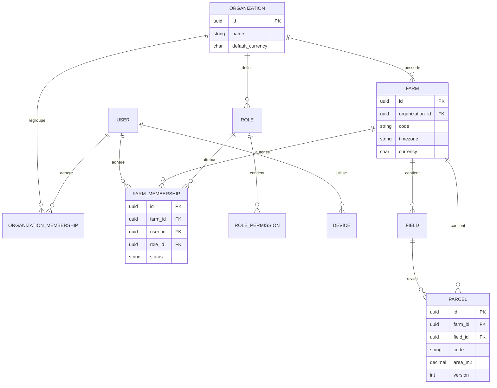
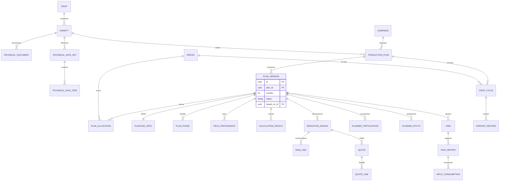
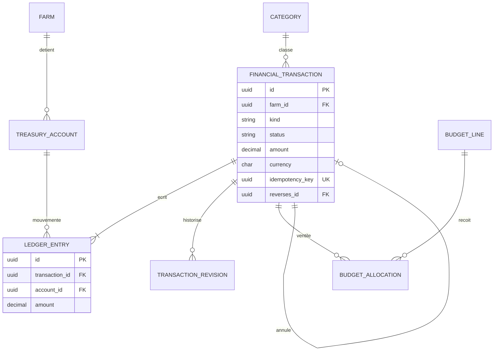
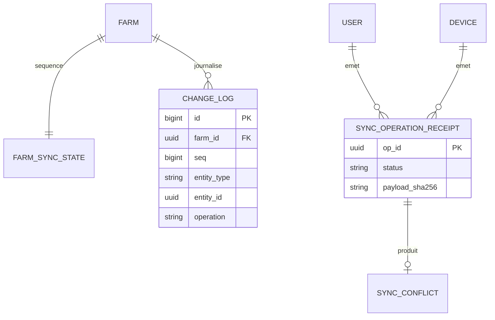

# DATABASE_SCHEMA.md

> Statut : proposition de référence (MVP + préparation P1). SGBD : PostgreSQL 17.
> Conventions : tables `snake_case`, préfixées par l'application Django (`fields_parcel`…). Les noms ci-dessous omettent le préfixe.

## 1. Conventions transverses

### 1.1 Colonnes communes

| Mixin | Colonnes | Usage |
|---|---|---|
| `UUIDModel` | `id uuid PK` (généré par le client ou le serveur, uuid4) | Toutes les tables métier |
| `TimestampedModel` | `created_at timestamptz`, `updated_at timestamptz` | Toutes |
| `AuthoredModel` | `created_by_id FK user NULL`, `updated_by_id FK user NULL` | Données saisies |
| `OrgScopedModel` | `organization_id FK NOT NULL` | Données de l'organisation |
| `FarmScopedModel` | `organization_id FK NOT NULL`, `farm_id FK NOT NULL` | Données de l'exploitation (organisation dénormalisée pour le filtrage et les contrôles) |
| `VersionedModel` | `version integer NOT NULL DEFAULT 1`, incrémentée à chaque mise à jour | Concurrence optimiste et synchronisation |
| `SoftDeleteModel` | `deleted_at timestamptz NULL`, `deleted_by_id` | Données descriptives uniquement (tombstones de synchronisation). **Jamais** pour la finance validée. |

Règles :
- Il n'y a pas de suppression en cascade (`CASCADE`) depuis une organisation ou une exploitation. Les clés étrangères sont en `PROTECT`, sauf sur les tables de détail purement dépendantes (lignes de devis d'un devis brouillon).
- Les unicités « fonctionnelles » sont **partielles** (`WHERE deleted_at IS NULL`).
- Les unités figurent dans le nom de colonne : `_m`, `_m2`, `_mm`, `_l`, `_m3`, `_lph` (L/h), `_m3h` (m³/h), `_bar`, `_kg`, `_g`, `_pct` (0 à 100), `_rate` (0 à 1), `_days`.
- Les décimaux agronomiques sont en `NUMERIC(14,4)`, les monétaires en `NUMERIC(19,4)`. Aucun `float`.
- Toutes les dates métier sont des `date` (dans le fuseau de l'exploitation). Les instants sont en `timestamptz` (UTC).

### 1.2 Règles multi-tenant en base

1. `farm_id` et `organization_id` sont `NOT NULL` sur toute table de portée exploitation.
2. Contrôle de cohérence : `CHECK` impossible entre tables, donc une **validation par service** vérifie que toute FK vers une table de portée exploitation référence la même `farm_id` que la ligne. Elle est testée par la suite d'isolation.
3. Les index composites commencent par `farm_id` (ou `organization_id`), ce qui sert à la fois les filtres de tenant et les performances.
4. La Row-Level Security PostgreSQL est prévue en P1 (`SET app.current_org`) comme défense en profondeur.

### 1.3 Stratégies d'historisation

| Stratégie | Tables | Mécanisme |
|---|---|---|
| Versions immuables | `plan_version`, `technical_data_set`, `irrigation_design`, `quote`, `price_list` | Une version validée n'est plus modifiable. Une modification crée une nouvelle version (`based_on_id`). |
| Ajout seul (événements) | `task_report`, `task_status_event`, `observation`, `harvest_record`, `financial_transaction`, `ledger_entry`, `input_consumption`, `audit_event`, `change_log`, `sync_operation_receipt` | Aucun `UPDATE` métier après validation. Corrections par événement compensatoire. |
| Révisions | `transaction_revision` | Copie avant chaque modification d'une transaction non validée |
| Audit générique | `audit_event` | Différence avant/après pour les entités descriptives (parcelles, rôles, adhésions) |
| Tombstones | `deleted_at` + `change_log(op='delete')` | Propagation des suppressions aux clients |

---

## 2. Identité et tenancy

### `users_user`
| Colonne | Type | Contraintes |
|---|---|---|
| id | uuid | PK |
| email | citext | NULL, UNIQUE si non NULL |
| phone | varchar(20) | NULL, E.164, UNIQUE si non NULL |
| full_name | varchar(200) | NOT NULL |
| password | varchar(128) | hachage Argon2 |
| locale | varchar(10) | défaut `fr` |
| is_active, is_staff, is_superuser | bool | |
| last_login, date_joined | timestamptz | |

CHECK : `email IS NOT NULL OR phone IS NOT NULL`.

### `users_device`
id PK · user_id FK · platform (`web`, `ios`, `android`) · label · client_version · last_seen_at · revoked_at NULL · created_at.
Index : (user_id).

### `organizations_organization`
id PK · name varchar(200) · slug UNIQUE · country char(2) · default_currency char(3) · default_timezone varchar(64) · default_locale · status (`active`, `suspended`) · version · timestamps.

### `organizations_organization_membership`
id PK · organization_id FK · user_id FK · is_org_admin bool · status (`active`, `disabled`) · timestamps.
UNIQUE (organization_id, user_id).

### `organizations_role`
id PK · organization_id FK · code varchar(64) · name · description · is_system bool (rôle initial, modifiable mais pas supprimable) · version · timestamps.
UNIQUE (organization_id, code).

### `organizations_role_permission`
id PK · role_id FK CASCADE · permission_code varchar(100).
UNIQUE (role_id, permission_code). Le `permission_code` est validé contre le catalogue défini dans le code.

### `farms_farm`
id PK · organization_id FK · name · code varchar(32) · country char(2) · region · locality · latitude NUMERIC(9,6) NULL · longitude NUMERIC(9,6) NULL · timezone · currency char(3) · locale · declared_area_m2 NUMERIC(14,4) NULL · settings jsonb (paramètres configurables : tolérances, auto-validation…) · status (`active`, `archived`) · version · soft delete · timestamps.
UNIQUE (organization_id, code) WHERE deleted_at IS NULL.

### `farms_farm_membership`
id PK · organization_id · farm_id FK · user_id FK · role_id FK · status (`active`, `disabled`) · valid_from date · valid_to date NULL · timestamps · version.
UNIQUE (farm_id, user_id) WHERE status='active'. Index (user_id, status).

### `organizations_invitation`
id PK · organization_id · farm_id NULL · role_id · email NULL · phone NULL · token_hash char(64) UNIQUE · expires_at · accepted_at NULL · accepted_by_id NULL · revoked_at NULL · invited_by_id · created_at.

### `audit_audit_event`
id bigserial PK · organization_id NULL · farm_id NULL · actor_id NULL · action varchar(100) · entity_type varchar(100) · entity_id uuid NULL · before jsonb · after jsonb · request_id · ip inet NULL · created_at.
Index (organization_id, created_at DESC), (entity_type, entity_id). Ajout seul (un trigger bloque UPDATE et DELETE).

---

## 3. Foncier

### `fields_field` (champ / îlot)
id PK · org · farm · name · code · description · area_m2 NUMERIC(14,4) NULL · geometry jsonb NULL (GeoJSON Polygon/MultiPolygon, WGS84) · version · soft delete · authored · timestamps.
UNIQUE (farm_id, code) WHERE deleted_at IS NULL.

### `fields_parcel`
| Colonne | Type | Contraintes |
|---|---|---|
| id, organization_id, farm_id | | |
| field_id | FK NULL | même exploitation |
| name | varchar(120) | NOT NULL |
| code | varchar(32) | UNIQUE (farm_id, code) partiel |
| area_m2 | NUMERIC(14,4) | CHECK > 0 |
| length_m, width_m | NUMERIC(10,3) NULL | CHECK > 0 |
| geometry | jsonb NULL | GeoJSON validé |
| latitude, longitude | NUMERIC(9,6) NULL | CHECK des bornes |
| soil_type | varchar(50) | NULL (énumération ouverte) |
| soil_ph | NUMERIC(3,1) NULL | CHECK 0 ≤ ph ≤ 14 |
| water_availability | varchar(20) | `none`, `low`, `medium`, `high`, `unknown` |
| water_notes | text | |
| notes | text | |
| status | varchar(20) | `active`, `fallow`, `archived` |
| version, deleted_at, authored, timestamps | | |

Règle de service : Σ `area_m2` des parcelles actives d'un champ ≤ `field.area_m2` × (1 + tolérance).

### `fields_soil_analysis` (P1)
parcel_id · sampled_on · lab · ph · organic_matter_pct · results jsonb · document_id FK file.

### `fields_parcel_history_entry`
Historique cultural antérieur au système : parcel_id · period_start · period_end · crop_label · notes · authored.

---

## 4. Référentiel végétal

### `crops_crop` (espèce)
id PK · organization_id **NULL** (global si NULL) · scientific_name · common_name · family · category (`vegetable`, `fruit`, `legume`, `cereal`, `other`) · version · timestamps.
UNIQUE (organization_id, common_name) NULLS NOT DISTINCT.

### `varieties_variety`
id PK · org · crop_id FK · name · seed_company · description · is_hybrid bool NULL · version · soft delete · timestamps.
UNIQUE (organization_id, crop_id, name, seed_company) partiel.

### `varieties_technical_document`
id PK · org · variety_id FK · file_id FK files · supplier · document_date NULL · language · title · status (`uploaded`, `extracted`, `reviewed`) · authored · timestamps.

### `varieties_technical_data_set`
id PK · org · variety_id · source_document_id NULL · version_number int · status (`draft`, `validated`, `superseded`) · validated_by_id · validated_at · based_on_id NULL · timestamps.
UNIQUE (variety_id, version_number). Au plus une version `validated` par variété (index unique partiel).

### `varieties_technical_data_item`
id PK · data_set_id FK CASCADE · key varchar(100) (catalogue de clés : `row_spacing`, `plant_spacing`, `cycle_days`, `germination_rate`, `seeds_per_gram`, `phase.<code>.duration_days`, `yield_potential`…) · value_numeric NUMERIC(14,4) NULL · value_min · value_max · value_text NULL · unit varchar(20) · provenance (`document`, `user_input`, `ai_extraction`) · source_page int NULL · source_section · source_quote text · confidence NUMERIC(3,2) NULL · validated bool · validated_by_id · notes.
UNIQUE (data_set_id, key).

---

## 5. Campagnes et plans de production (objet central)

### `production_plans_campaign`
id PK · org · farm · name · start_date · end_date · status (`planned`, `active`, `closed`) · version · soft delete.
CHECK end_date ≥ start_date.

### `production_plans_production_plan`
id PK · org · farm · campaign_id FK · variety_id FK · name · status (`draft`, `validated`, `in_progress`, `closed`, `cancelled`) · current_version_id FK NULL (dernière version validée) · version · authored · timestamps.

### `production_plans_plan_version`
| Colonne | Type | Notes |
|---|---|---|
| id, org, farm | | |
| plan_id | FK | |
| number | int | UNIQUE (plan_id, number) |
| status | `draft`, `validated`, `superseded`, `rejected` | Une seule `validated` par plan (index partiel) |
| origin | `manual`, `ai_draft`, `copy` | |
| based_on_id | FK NULL self | Comparaison des hypothèses (FR-034) |
| technical_data_set_id | FK NULL | Référentiel utilisé |
| planned_start_date, planned_end_date | date | |
| target_yield_kg_per_ha | NUMERIC NULL | |
| objectives | text | |
| change_note | text | |
| validated_by_id, validated_at | | |
| engine_version | varchar(20) | |
| version | int | concurrence optimiste du brouillon |

Immutabilité : si `status <> 'draft'`, aucune modification du contenu (service + trigger).

### `production_plans_plan_allocation`
id · plan_version_id FK CASCADE · parcel_id FK · allocated_area_m2 · non_plantable_area_m2 (allées, chemins, bordures) · notes.
UNIQUE (plan_version_id, parcel_id). CHECK non_plantable ≤ allocated.

### `production_plans_planting_spec` (1:1 avec plan_version)
plan_version_id PK/FK · planting_method (`direct_seeding`, `transplanting`) · layout (`single_row`, `beds`) · row_spacing_m · plant_spacing_m · plants_per_hole · seeds_per_hole · bed_width_m NULL · path_width_m NULL · rows_per_bed NULL · headland_m NULL · germination_rate (0 à 1) · nursery_success_rate NULL · safety_margin_rate · seeds_per_gram NULL · thousand_seed_weight_g NULL · seed_package_size_g NULL.
Les **résultats calculés ne sont pas stockés ici** : ils sont dans `calculation_result` (traçabilité).

### `production_plans_plan_phase`
id · plan_version_id · phase_code (`soil_preparation`, `sowing`, `transplanting`, `vegetative`, `flowering`, `fruiting`, `maturation`, `harvest`, ou code personnalisé) · sequence int · start_date · end_date · offset_days_from_start · duration_days.
UNIQUE (plan_version_id, sequence).

### `production_plans_field_provenance`
id · plan_version_id · field_path varchar(150) (exemple `planting_spec.row_spacing_m`) · source_kind (`document`, `calculation`, `ai_suggestion`, `user_input`) · technical_data_item_id NULL · calculation_result_id NULL · ai_suggestion_id NULL · set_by_id NULL · note · created_at.
UNIQUE (plan_version_id, field_path).

### `production_plans_calculation_result`
id · org · farm · plan_version_id NULL · calc_type varchar(60) · engine_version · inputs jsonb · outputs jsonb · assumptions jsonb · warnings jsonb · formula text · computed_at · computed_by_id.
Index (plan_version_id, calc_type).

### `production_plans_crop_cycle`
id · org · farm · parcel_id · plan_id · plan_version_id · area_m2 · start_date · end_date · status (`planned`, `active`, `harvested`, `closed`, `cancelled`) · version.
Règle (Q1) : pour une parcelle, la somme des `area_m2` des cycles non annulés dont les dates se chevauchent doit rester ≤ `parcel.area_m2`. Le contrôle est fait par le service sous `SELECT … FOR UPDATE` de la parcelle.
Index (farm_id, parcel_id, start_date, end_date).

---

## 6. Irrigation, catalogue et devis

### `inventory_supplier`
id · org · name · kind (`supplier`, `customer`, `both`) · phone · email · address · notes · version · soft delete.

### `inventory_catalog_item`
id · org · category (`pipe`, `dripline`, `emitter`, `filter`, `valve`, `regulator`, `pump`, `injector`, `fitting`, `seed`, `fertilizer`, `phyto`, `other`) · name · reference · base_unit (`m`, `piece`, `kg`, `l`, `roll`) · spec jsonb (diamètre_mm, PN_bar, débit_lph, longueur_rouleau_m, composition…) · version · soft delete.

### `inventory_price_list` et `inventory_price_list_item`
price_list : id · org · supplier_id · currency · valid_from · valid_to NULL · status (`draft`, `active`, `archived`) · notes.
item : id · price_list_id · catalog_item_id · unit · unit_price NUMERIC(19,4) · min_quantity NULL.
UNIQUE (price_list_id, catalog_item_id, unit).

### `irrigation_irrigation_design`
id · org · farm · plan_version_id NULL · parcel_id · number · status (`draft`, `validated`, `superseded`) · system_type (`drip`, `sprinkler`, `micro_sprinkler`, `other`) · based_on_id · parameters jsonb (entrées validées par un schéma, voir AGRONOMY_ENGINE §4) · calculation_result_id FK · validated_by/at · version · authored.

### `irrigation_bom_line`
id · design_id CASCADE · component_type · catalog_item_id NULL · description · quantity NUMERIC(14,4) · unit · rounding_rule · rationale text (provenance de la quantité).

### `irrigation_quote` / `irrigation_quote_line`
quote : id · org · farm · design_id NULL · plan_version_id NULL · supplier_id NULL · price_list_id NULL · number · currency · status (`draft`, `issued`, `accepted`, `rejected`, `superseded`) · subtotal · total · assumptions jsonb · version.
line : id · quote_id · bom_line_id NULL · catalog_item_id NULL · description · quantity · unit · unit_price (**copié au moment du devis**) · line_total · notes.
Un devis `issued` est immuable.

---

## 7. Programme agronomique

### `agronomy_input_product`
id · org · catalog_item_id NULL · kind (`fertilizer`, `phyto`, `amendment`, `seed`) · name · manufacturer · composition jsonb (exemple `{"N": 15, "P2O5": 15, "K2O": 15}` en % massique) · formulation · density_kg_per_l NULL · active_ingredients jsonb (phyto) · registration_number · registration_country · registration_valid_until NULL · label_file_id NULL · version.

### `agronomy_planned_fertilization`
id · plan_version_id · product_id · phase_code NULL · day_offset NULL · basis (`per_ha`, `per_plant`, `per_m2`) · dose_value NUMERIC · dose_unit (`kg`, `g`, `l`, `ml`) · target_nutrient NULL (`N`, `P2O5`, `K2O`…) · target_nutrient_dose_kg_per_ha NULL · method (`fertigation`, `broadcast`, `localized`, `foliar`) · provenance FK field_provenance · computed_total_quantity · computed_unit · calculation_result_id.

### `agronomy_planned_phyto_intervention`
id · plan_version_id · product_id · target (ravageur ou maladie) · phase_code / day_offset · dose_value · dose_unit · basis · pre_harvest_interval_days · reentry_interval_hours · label_reference text **NOT NULL** · notes.
Règle : `dose_value` exige une provenance `document` (étiquette) ou `user_input`. L'IA est interdite.

### `agronomy_planned_irrigation`
id · plan_version_id · phase_code · et0_mm_per_day · kc · efficiency_rate · gross_need_l_per_day · frequency_days · duration_minutes · calculation_result_id.

### `agronomy_observation` (hors ligne, ajout seul)
id (UUID client) · org · farm · parcel_id · crop_cycle_id NULL · observed_at · kind (`pest`, `disease`, `growth`, `weather`, `other`) · target · severity (1 à 5) · affected_area_pct · notes · author_id · device_id · created_at.

---

## 8. Tâches et exécution

### `tasks_team`, `tasks_team_member`
team : id · org · farm · name · version. member : team_id · user_id, UNIQUE.

### `tasks_task`
| Colonne | Notes |
|---|---|
| id, org, farm | |
| plan_version_id NULL | Tâche générée depuis la version validée |
| crop_cycle_id NULL, parcel_id NULL | |
| task_type | `soil_preparation`, `sowing`, `transplanting`, `fertilization`, `phyto`, `irrigation`, `weeding`, `pruning`, `harvest`, `other` |
| title, description | |
| planned_start_date, planned_end_date | |
| status | `todo`, `in_progress`, `done`, `cancelled`, `to_verify`. **« En retard » est calculé** (`planned_end_date < aujourd'hui` et statut ∈ {todo, in_progress}), jamais stocké. |
| origin | `generated`, `manual` |
| source_ref | référence de l'élément du plan (phase, fertilisation…) |
| generation_batch_id NULL | |
| superseded_by_id NULL | FR-064 |
| version, authored | |

Index (farm_id, status, planned_start_date), (farm_id, plan_version_id).

### `tasks_task_assignment`
task_id · user_id NULL · team_id NULL · CHECK une seule cible renseignée.

### `tasks_task_status_event` (ajout seul)
task_id · from_status · to_status · actor_id · occurred_at · reason · op_id NULL.

### `tasks_task_report` (ajout seul, hors ligne)
id (UUID client) · org · farm · task_id · reported_by_id · actual_start · actual_end · duration_minutes · completion (`partial`, `complete`) · notes · deviation_notes · photos (via `tasks_task_report_attachment`) · created_at · device_id.

### `tasks_input_consumption` (FR-082)
id · org · farm · task_report_id · product_id · quantity NUMERIC · unit · quantity_base NUMERIC (kg ou L) · plan_version_id (dénormalisé) · lot_number NULL.

---

## 9. Finance

### `finance_treasury_account`
id · org · farm · name · kind (`cash`, `bank`, `mobile_money`, `other`) · currency char(3) · institution · account_ref (masqué) · is_active · version.
UNIQUE (farm_id, name).

### `finance_category`
id · org · kind (`expense`, `income`) · code · name · parent_id NULL · is_active.
UNIQUE (organization_id, kind, code).

### `finance_financial_transaction`
| Colonne | Type | Contraintes |
|---|---|---|
| id | uuid | PK (UUID client possible) |
| org, farm | | |
| kind | `expense`, `income`, `transfer`, `reversal`, `opening` | |
| status | `submitted`, `validated`, `rejected`, `reversed` | |
| business_date | date | |
| amount | NUMERIC(19,4) | CHECK > 0 (valeur absolue, le signe est porté par les écritures) |
| currency | char(3) | = devise du ou des comptes |
| category_id | FK NULL | obligatoire pour expense et income |
| description | text | |
| counterparty_id | FK supplier NULL | fournisseur ou client |
| campaign_id, plan_id, crop_cycle_id | FK NULL | |
| reverses_id | FK self NULL | UNIQUE (une transaction n'est annulée qu'une fois) |
| corrects_id | FK self NULL | |
| idempotency_key | uuid | **UNIQUE (farm_id, idempotency_key)** |
| created_offline | bool | |
| device_id | FK NULL | |
| client_created_at | timestamptz NULL | |
| validated_by_id, validated_at | | |
| rejected_reason | text | |
| revision | int | incrémentée par TransactionRevision |
| authored, timestamps | | |

Index (farm_id, business_date), (farm_id, status), (farm_id, campaign_id).
Trigger : si `OLD.status IN ('validated','reversed')`, interdiction de modifier amount, currency, business_date, kind et les écritures. DELETE interdit si la transaction n'est pas `submitted`.

### `finance_ledger_entry`
id · transaction_id FK PROTECT · account_id FK · amount NUMERIC(19,4) (signé, ≠ 0) · currency.
Index (account_id, transaction_id). CHECK `amount <> 0`. Pour un transfert, Σ amount = 0 (contrôle par service).

Solde du compte = `SUM(le.amount)` sur les écritures dont la transaction a `status IN ('validated','reversed')`. Une transaction annulée passe à `reversed` mais reste comptée. Sa transaction d'annulation (`kind='reversal'`, `status='validated'`) porte les écritures opposées, donc l'effet net est nul et l'historique reste intact.

### `finance_transaction_revision`
id · transaction_id · revision · snapshot jsonb · changed_by_id · changed_at · reason.

### `finance_transaction_attachment`
transaction_id · file_id · UNIQUE.

### `finance_budget_line`
id · org · farm · campaign_id NULL · plan_version_id NULL · category_id · label · planned_amount · currency · source_quote_id NULL · version.

### `finance_budget_allocation`
id · transaction_id · budget_line_id · amount NUMERIC(19,4) CHECK > 0 · created_by.
UNIQUE (transaction_id, budget_line_id). Service : Σ allocations ≤ transaction.amount, et même devise.

---

## 10. Récolte

### `harvest_unit_conversion`
id · org · farm · crop_id · unit (`crate`, `piece`, `bag`…) · kg_per_unit NUMERIC · measured_on · notes · version.

### `harvest_harvest_record` (ajout seul, hors ligne)
id (UUID client) · org · farm · crop_cycle_id · parcel_id · harvested_on · quantity · unit · quantity_kg (calculé avec la conversion) · conversion_factor_used NULL · quality_grade (`extra`, `grade_1`, `grade_2`, `rejected`, ou personnalisé) · loss_quantity_kg · loss_reason · responsible_id · notes · device_id · created_at.

### `harvest_sale` (lien optionnel vers la recette)
id · org · farm · crop_cycle_id · sold_on · customer_id · quantity_kg · unit_price · currency · income_transaction_id FK NULL.

---

## 11. IA

### `ai_assistant_extraction_run`
id · org · document_id · provider · model · prompt_version · schema_version · status (`queued`, `running`, `succeeded`, `failed`) · raw_output jsonb · error_code · error_message · started_at · finished_at · requested_by_id.

### `ai_assistant_plan_generation_run`
id · org · farm · plan_id · plan_version_id NULL (brouillon créé) · input_snapshot jsonb · output jsonb · missing_info jsonb · status · provider · model · prompt_version · requested_by_id · timestamps.

### `ai_assistant_ai_suggestion`
id · run_id · field_path · value jsonb · unit · rationale text · cited_technical_data_item_id NULL · status (`suggested`, `accepted`, `modified`, `rejected`) · decided_by_id · decided_at.

### `ai_assistant_ai_request_log`
id bigserial · org · run_type · run_id · provider · model · input_tokens · output_tokens · estimated_cost NUMERIC(12,6) · cost_currency · latency_ms · status · error_code · created_at.

---

## 12. Fichiers

### `files_stored_file`
id (UUID client possible) · org · farm NULL · storage_key UNIQUE · original_name · declared_mime · detected_mime · size_bytes · sha256 char(64) · purpose (`technical_sheet`, `receipt`, `task_photo`, `observation_photo`, `label`, `other`) · status (`pending_upload`, `available`, `quarantined`, `rejected`) · uploaded_by_id · uploaded_at · created_at.
Index (farm_id, purpose), (sha256).

---

## 13. Synchronisation

### `synchronization_farm_sync_state`
farm_id PK · last_seq bigint NOT NULL DEFAULT 0. Ligne verrouillée (`FOR UPDATE`) dans chaque transaction d'écriture synchronisable.

### `synchronization_change_log`
| Colonne | Notes |
|---|---|
| id bigserial PK | |
| farm_id | |
| seq bigint | UNIQUE (farm_id, seq) |
| entity_type | `fields.parcel`… |
| entity_id uuid | |
| operation | `upsert`, `delete` |
| entity_version | int |
| required_permission | code de lecture (filtrage du pull) |
| changed_at | |
| origin_op_id | uuid NULL |

Index (farm_id, seq). Le pull relit l'état courant de l'entité (pas de copie de charge utile), ce qui évite le stockage en double. Compaction : seule la dernière entrée par entité est utile au pull (P1 : purge des entrées remplacées au-delà de 90 jours).

### `synchronization_sync_operation_receipt`
op_id uuid PK (clé d'idempotence) · org · farm · user_id · device_id · entity_type · entity_id · op_type · base_version NULL · payload_sha256 · status (`applied`, `rejected`, `conflict`) · result jsonb (version obtenue ou erreur) · client_created_at · received_at · processed_at.
Un rejeu avec le même `op_id` mais un `payload_sha256` différent produit un rejet `IDEMPOTENCY_KEY_REUSED`.

### `synchronization_sync_conflict`
id · org · farm · receipt_op_id FK · entity_type · entity_id · conflict_type (`stale_version`, `field_conflict`, `invalid_transition`, `possible_duplicate`, `rule_violation`) · fields jsonb · client_payload jsonb · server_snapshot jsonb · status (`open`, `resolved`, `dismissed`) · resolution (`keep_server`, `apply_client`, `merged`, `manual`) · resolved_by_id · resolved_at · created_at.

---

## 14. ERD Mermaid

### 14.1 Tenancy et foncier

### 14.2 Plans de production

### 14.3 Finance

### 14.4 Synchronisation

