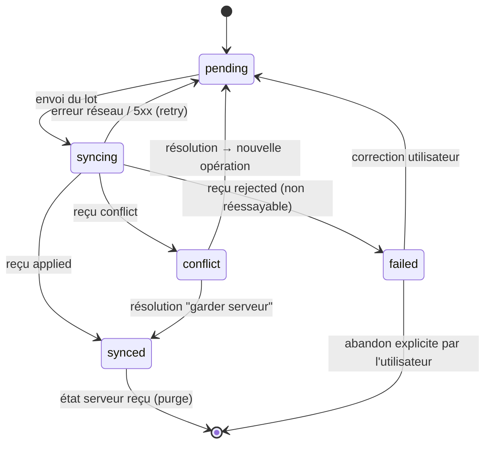

# OFFLINE_SYNC.md — Architecture offline-first

> Exigences couvertes : FR-110 à FR-115, NFR-003, CLAUDE.md §8.

## 1. Périmètre hors ligne

| Donnée | Lecture hors ligne | Écriture hors ligne | Stratégie |
|---|---|---|---|
| Exploitations, adhésions, rôles effectifs | oui | non | serveur uniquement |
| Champs, parcelles | oui | oui (modification descriptive) | concurrence optimiste + fusion à trois (§6.1) |
| Variétés, données techniques validées | oui | non | serveur uniquement |
| Plans validés, phases, programme | oui | non (Q7) | serveur uniquement |
| Tâches | oui | changement de statut | machine d'états (§6.2) |
| Comptes rendus, consommations, observations | oui | création | ajout seul |
| Récoltes | oui | création | ajout seul |
| Transactions financières | oui (si permission) | création, demande d'annulation | ajout seul, immuable (§7) |
| Photos et justificatifs | oui (cache local) | création | file de fichiers (§8) |

## 2. Stockage local

### 2.1 Web : IndexedDB (Dexie)

Base `fms-<userId>` (une base par utilisateur, ce qui isole les données sur un poste partagé). Tables :

| Table | Clé | Index | Contenu |
|---|---|---|---|
| `entities_<type>` | `id` | `farmId`, champs de recherche | Dernier état serveur connu, plus `localOverlay` (modifications non confirmées) |
| `outbox` | `opId` | `[farmId+status]`, `createdAt`, `entityId` | Opérations (§3) |
| `files` | `fileId` | `status` | Blob, métadonnées, `uploadStatus` |
| `sync_state` | `farmId` | | `cursor`, `lastPullAt`, `lastPushAt`, `schemaVersion` |
| `conflicts` | `conflictId` | `farmId` | Conflits renvoyés par le serveur |

- `navigator.storage.persist()` est demandé. En cas de refus, un avertissement permanent est affiché.
- L'estimation du quota (`navigator.storage.estimate()`) est surveillée : avertissement à 80 %.
- Toute écriture locale (entité + opération) se fait dans **une même transaction Dexie** : une opération ne peut pas exister sans sa modification locale, et inversement.

### 2.2 Mobile : SQLite (expo-sqlite)

Même schéma logique, en tables SQL (`entities_parcel`, `outbox`, `files`, `sync_state`, `conflicts`). Le mode WAL est activé, et chaque écriture locale est une transaction SQL. Les pièces jointes sont copiées dans `FileSystem.documentDirectory/attachments/`, et la ligne stocke le chemin.

### 2.3 Lecture

L'interface lit **état serveur + superposition locale** : les opérations `pending`, `syncing`, `failed` ou `conflict` sont réappliquées dans l'ordre sur le dernier état serveur. Une opération confirmée (`synced`) n'est retirée qu'une fois l'état serveur correspondant reçu (version ≥ version renvoyée).

## 3. File d'attente des opérations (outbox)

```ts
interface LocalOperation {
  opId: string;            // UUID v4, clé d'idempotence
  opType: "create" | "update" | "delete" | "command";
  command?: string;        // ex. "task.change_status", "finance.request_reversal"
  entityType: string;      // ex. "fields.parcel"
  entityId: string;        // UUID (généré par le client pour une création)
  farmId: string;
  payload: unknown;        // champs modifiés uniquement (update) ou objet complet (create)
  baseVersion: number | null;      // version serveur sur laquelle l'opération a été construite
  baseValues?: Record<string, unknown>; // valeurs de base des champs modifiés (fusion à trois)
  authorId: string;
  deviceId: string;
  createdAt: string;       // ISO 8601, horloge client
  version: 1;              // version du format d'opération
  status: "pending" | "syncing" | "synced" | "failed" | "conflict";
  attempts: number;
  lastError?: { code: string; message: string; retryable: boolean };
  dependsOn?: string[];    // opIds qui doivent être appliqués avant
  serverResult?: { entityVersion: number };
}
```

Machine d'états :



Règles :
- **Jamais de suppression avant confirmation serveur** (`synced`, puis réception de l'état), ou avant un abandon explicite de l'utilisateur pour `failed`. L'abandon d'une opération financière est journalisé localement et exportable.
- Les `update` successifs d'une même entité encore `pending` peuvent être **compactés** (fusion des charges utiles, conservation de la `baseVersion` la plus ancienne). Cela ne s'applique jamais aux opérations financières ni aux événements.
- Ordre : FIFO par exploitation. Une opération dont l'entité de dépendance (`dependsOn`) a échoué reste bloquée, avec le statut `failed` et le code `DEPENDENCY_FAILED`.
- Une opération restée en `syncing` au démarrage de l'application (crash pendant l'envoi) repasse en `pending`. L'idempotence serveur garantit l'absence de double application.

## 4. Protocole de synchronisation

### 4.1 Séquence

1. Déclencheurs : démarrage, retour du réseau, intervalle (60 s en ligne), action manuelle, après chaque écriture locale (avec un délai de 2 s).
2. Rafraîchissement du jeton si nécessaire. En cas d'échec d'authentification, la synchronisation est suspendue, la file conservée, et l'utilisateur invité à se reconnecter.
3. **Push** des fichiers prêts (§8), puis des opérations par lots (≤ 100 opérations ou ≤ 512 Ko).
4. **Pull** jusqu'à `has_more = false`.
5. Mise à jour des indicateurs.

Verrou : une seule boucle active (Web Locks API sur le Web, mutex en mémoire sur mobile).

### 4.2 Push

`POST /api/v1/sync/push`

```json
{
  "device_id": "uuid",
  "client_version": "web@0.3.0",
  "protocol_version": 1,
  "operations": [
    {
      "op_id": "uuid",
      "farm_id": "uuid",
      "op_type": "update",
      "entity_type": "fields.parcel",
      "entity_id": "uuid",
      "base_version": 3,
      "base_values": {"name": "P1"},
      "payload": {"name": "Parcelle Nord"},
      "created_at": "2026-11-08T08:12:00Z"
    }
  ]
}
```

Réponse `200` (même si certaines opérations sont refusées : un échec partiel est normal) :

```json
{
  "results": [
    {"op_id": "uuid", "status": "applied", "entity_version": 4},
    {"op_id": "uuid", "status": "conflict", "conflict_id": "uuid", "conflict_type": "field_conflict", "server": {}},
    {"op_id": "uuid", "status": "rejected", "error": {"code": "PERMISSION_DENIED", "retryable": false}}
  ],
  "server_time": "2026-11-08T09:00:00Z"
}
```

Traitement serveur, **pour chaque opération, dans sa propre transaction** :
1. Recherche du reçu par `op_id`. S'il existe et que `payload_sha256` est identique, le serveur renvoie le résultat stocké (**rejeu**). Si le hachage diffère, il rejette avec `IDEMPOTENCY_KEY_REUSED`.
2. Résolution du contexte du tenant pour `farm_id`. Sans adhésion active, rejet avec `NOT_FOUND`.
3. Vérification de la permission **actuelle** de l'auteur. Le jeton doit correspondre à `author`, car on ne peut pas soumettre au nom d'un autre utilisateur.
4. Le **handler** déclaré pour `entity_type` / `command` appelle le service métier (le même que l'API REST).
5. Écriture du `ChangeLog` (séquence de l'exploitation) et du reçu dans la même transaction.
6. Si une contrainte d'unicité échoue sur le reçu (deux requêtes concurrentes avec le même `op_id`), la transaction est annulée, le reçu gagnant est relu et son résultat renvoyé.

Les erreurs réessayables (`retryable: true` : verrou, indisponibilité temporaire) laissent l'opération `pending` côté client. Les erreurs non réessayables la passent en `failed`.

### 4.3 Pull

`GET /api/v1/sync/pull?farm_id=…&cursor=<seq>&limit=500`

```json
{
  "changes": [
    {"seq": 1042, "entity_type": "fields.parcel", "entity_id": "uuid", "operation": "upsert", "version": 4, "data": {}},
    {"seq": 1043, "entity_type": "tasks.task", "entity_id": "uuid", "operation": "delete", "version": 7}
  ],
  "next_cursor": 1043,
  "has_more": false,
  "purge": []
}
```

- Le serveur sélectionne les entrées `seq > cursor` pour l'exploitation, garde **la dernière par entité** dans la page, filtre par permission de lecture et sérialise l'état courant.
- Une entité non visible pour l'utilisateur (permission manquante) n'apparaît pas. Le curseur avance quand même.
- `purge` : liste d'`entity_type` (ou `"*"`) que le client doit effacer (révocation de permission ou d'adhésion).
- **Premier chargement** : `cursor=0`, ce qui renvoie l'ensemble par pages.
- Si le curseur est trop ancien (compaction), le serveur répond `410 Gone` et le client refait un chargement complet **sans toucher à l'outbox**.

## 5. Séquence et fiabilité du curseur

Problème : une séquence PostgreSQL globale (`bigserial`) attribue les numéros au début de la transaction. Une transaction longue peut donc valider le numéro 10 après que le 11 a déjà été lu, et le 10 serait manqué.

Solution retenue : `FarmSyncState(farm_id, last_seq)`. Chaque transaction d'écriture synchronisable fait `SELECT … FOR UPDATE` sur la ligne de l'exploitation, incrémente `last_seq` et écrit le `ChangeLog`. Les numéros d'une exploitation sont donc attribués **dans l'ordre de validation** : un lecteur qui voit `seq = n` a nécessairement déjà vu tous les `seq < n` validés.

Coût : les écritures synchronisables d'une même exploitation sont sérialisées pendant quelques millisecondes. C'est acceptable pour 10 à 30 utilisateurs. Le verrou est pris **en fin** de transaction métier (juste avant le commit) pour minimiser la durée.

## 6. Détection et résolution des conflits

### 6.1 Données descriptives (fusion à trois)

Le client envoie `base_version`, `base_values` (valeurs de base des champs modifiés) et `payload`.
- Si `base_version == version serveur`, la modification est appliquée.
- Sinon, champ par champ :
  - Valeur serveur actuelle == `base_values[f]` : seul le client a modifié le champ, sa valeur est appliquée.
  - Valeur serveur actuelle == `payload[f]` : convergence, rien à faire.
  - Sinon : **conflit sur le champ**.
- S'il n'y a aucun champ en conflit, le serveur applique la fusion (statut `applied`) et le signale dans le résultat (`merged: true`).
- S'il y a au moins un champ en conflit, rien n'est appliqué, un `SyncConflict(field_conflict)` est créé et renvoyé avec l'état serveur. L'interface affiche les deux valeurs. L'utilisateur choisit, ce qui génère une nouvelle opération avec la nouvelle `base_version`, ou « garder le serveur ».
- Modification d'une entité supprimée côté serveur : conflit `stale_version` (deleted), avec possibilité de recréer.

### 6.2 Événements agricoles

- Comptes rendus, observations, récoltes et consommations sont des **créations en ajout seul** à UUID client : il n'y a pas de conflit d'écriture possible, et le rejeu est sans effet.
- Changement de statut de tâche : `command: task.change_status {from, to}`.
  - Si `from` correspond au statut serveur, la transition est appliquée si elle est valide.
  - Si la tâche a déjà atteint l'état cible (deux personnes l'ont terminée), la transition est convergente et appliquée sans effet. Le compte rendu est conservé.
  - Si la transition est incompatible (par exemple `done` côté client alors que la tâche a été `cancelled` sur le serveur), le compte rendu est **conservé**, la tâche passe à `to_verify` et un `SyncConflict(invalid_transition)` est créé pour le responsable.
- Un compte rendu sur une tâche remplacée (FR-064) est accepté et rattaché à la tâche d'origine. **L'historique n'est jamais réécrit.**

### 6.3 Modifications concurrentes de structure

Les plans, les devis et la conception ne sont pas modifiables hors ligne (Q7). En ligne, le contrôle `If-Match` ou `version` s'applique : un `409` renvoie l'état serveur.

## 7. Conflits financiers

Principes : **aucune fusion automatique, aucun écrasement, aucun « last write wins »**.

| Situation | Traitement |
|---|---|
| Rejeu du même `op_id` | Résultat stocké renvoyé, pas de seconde écriture (UNIQUE `op_id` et UNIQUE `(farm_id, idempotency_key)`) |
| Même transaction renvoyée par un autre canal (REST puis sync) | La même `idempotency_key` (= `op_id` de création) produit un rejeu |
| Doublon probable (même compte, montant, date, catégorie, autre auteur ou autre appareil, à moins de 24 h d'intervalle) | Transaction **acceptée** en `submitted` (jamais auto-validée) avec un drapeau `possible_duplicate` et un `SyncConflict(possible_duplicate)`. Le gestionnaire financier valide ou rejette. |
| Compte désactivé ou supprimé entre-temps | `rejected` (`ACCOUNT_INACTIVE`), opération `failed` côté client, que l'utilisateur doit réaffecter (nouvelle opération) |
| Permission retirée | `rejected` (`PERMISSION_DENIED`), conservée localement et exportable |
| Demande d'annulation d'une transaction déjà annulée | Convergent : `applied` sans effet, la référence de l'annulation existante est renvoyée |
| Demande d'annulation concurrente avec une correction | La première validée gagne. La seconde produit un `SyncConflict(rule_violation)`. Rien n'est écrit. |
| Date antidatée au-delà de la limite (Q9) | Acceptée et forcée en `submitted` |
| Devise différente de celle du compte | `rejected` (`CURRENCY_MISMATCH`) |
| Solde négatif d'un compte espèces | Accepté (la réalité du terrain prime), avec un avertissement sur le tableau de trésorerie |

Côté client : les transactions locales non confirmées sont affichées avec le libellé « en attente de synchronisation ». Le **solde affiché hors ligne** est « solde validé connu + mouvements locaux en attente », présenté comme *provisoire*.

## 8. Fichiers (FR-115)

1. Création locale d'un `StoredFile` (UUID client), puis compression de l'image.
2. Opération métier qui référence `file_id`, indépendante de l'envoi.
3. File de fichiers : `POST /api/v1/farms/{farm}/files/` avec `{id, purpose, size, sha256, mime}` → URL pré-signée de dépôt (ou envoi multipart direct, en repli). Puis dépôt et `POST …/files/{id}/complete`.
4. Le serveur accepte les opérations qui référencent un fichier `pending_upload` du même auteur et de la même exploitation. Le lien devient effectif à l'arrivée du fichier.
5. Reprise : un fichier dont l'envoi a échoué est réessayé avec un délai exponentiel. Un fichier n'est supprimé localement qu'après `available` côté serveur **et** la confirmation de l'opération liée.

## 9. Reprise après interruption

| Interruption | Comportement |
|---|---|
| Coupure pendant le push | Opérations `syncing` remises en `pending`, renvoyées, rejeu idempotent côté serveur |
| Réponse perdue après application serveur | Le renvoi retrouve le reçu, le résultat stocké est renvoyé |
| Coupure pendant le pull | Le curseur n'est enregistré qu'après l'application locale réussie de la page (transaction locale) |
| Crash de l'application | Transactions locales atomiques : pas d'état intermédiaire |
| Jeton expiré | File conservée, reconnexion, reprise |
| Version d'application obsolète (`426`) | File conservée et lisible. Une mise à jour est proposée, la migration locale préserve l'outbox. |
| Lot partiellement refusé | Chaque opération a son propre résultat. Les suivantes continuent, sauf dépendance. |

Délai de nouvelle tentative : exponentiel (2 s, 4 s… plafonné à 5 min) avec gigue. Après 10 échecs réseau consécutifs, l'opération reste `pending`, et une alerte « synchronisation en échec depuis X » s'affiche.

## 10. Tests exigés

Serveur (pytest) :
- Rejeu identique → un seul enregistrement, résultat identique.
- Même `op_id`, charge utile différente → `IDEMPOTENCY_KEY_REUSED`.
- Deux push concurrents du même `op_id` (threads) → une seule application.
- Fusion à trois : champs disjoints → fusion. Même champ → conflit, aucune écriture.
- Lot avec une opération invalide au milieu → les autres sont appliquées.
- Pull : pagination, dernier état par entité, tombstones, filtrage par permission, aucune donnée d'une autre organisation, `410` si le curseur est compacté.
- Ordre des séquences sous écritures concurrentes (aucun trou visible).
- Doublon financier probable → `submitted` + conflit, jamais auto-validé.
- Révocation d'adhésion → purge et refus des opérations.

Client (Vitest, sync-core avec un faux transport) :
- Perte de connexion pendant le push, retour → aucune perte, aucun doublon.
- Crash simulé en `syncing` → reprise.
- Compactage des `update`, mais pas des opérations financières.
- Superposition locale sur l'état serveur.
- E2E Playwright avec le réseau coupé (`context.setOffline(true)`).
